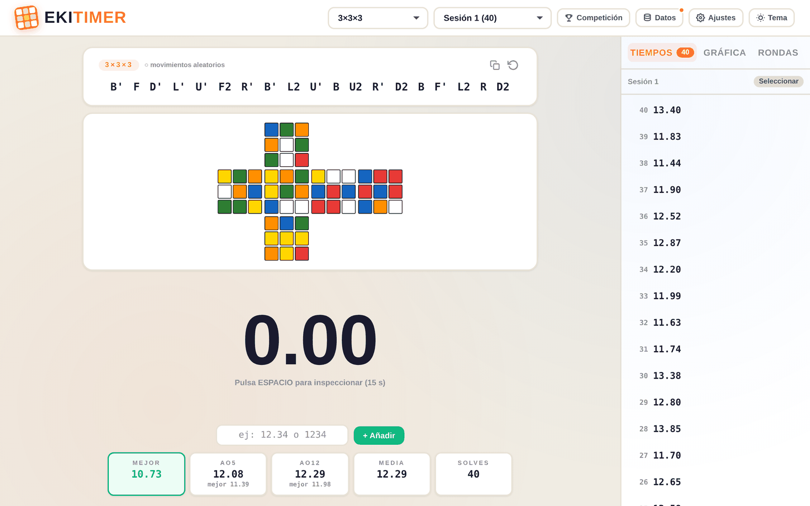
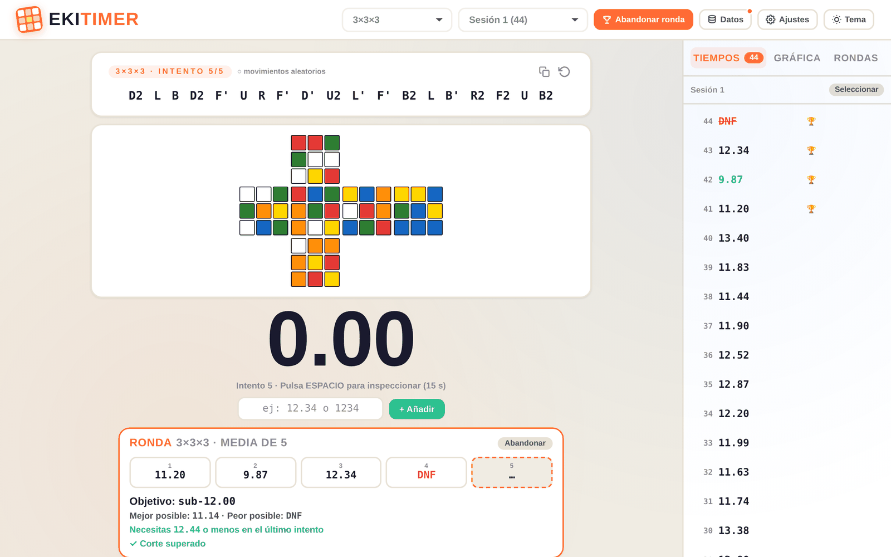
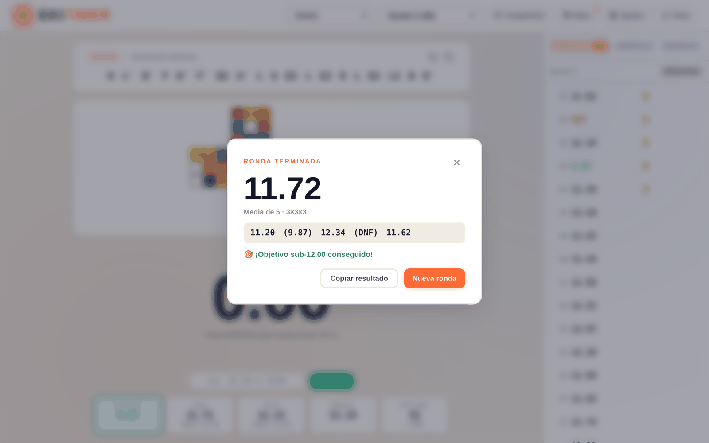
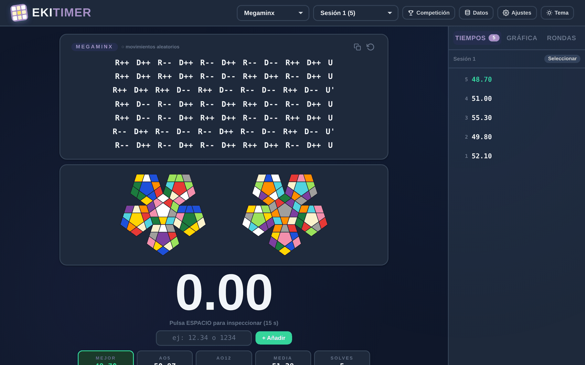
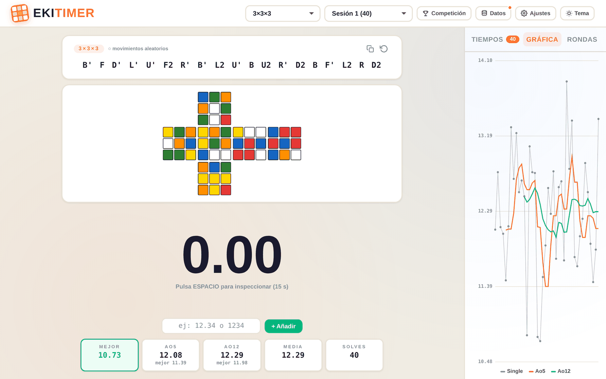
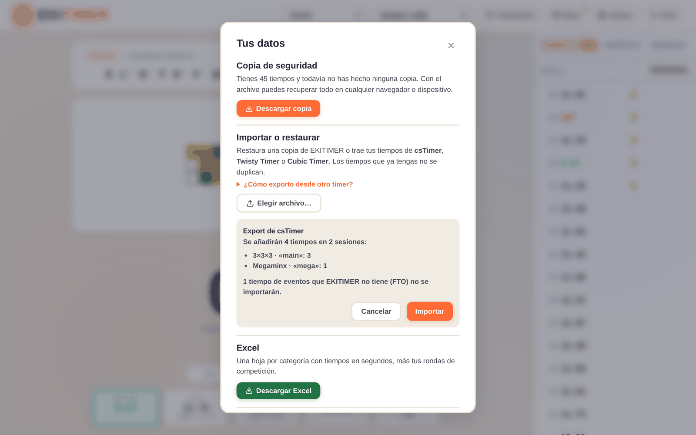
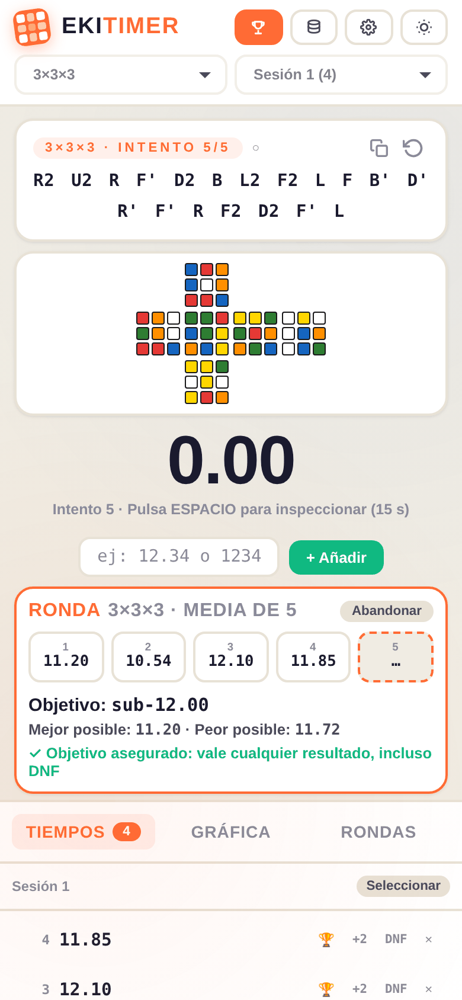

<p align="center">
  
</p>

<h1 align="center">EKITIMER</h1>

<p align="center">
  <b>El timer de speedcubing para entrenar como en una competición WCA.</b><br>
  Gratis, sin cuenta, sin anuncios y funciona sin conexión.
</p>

<p align="center">
  <a href="https://ekaitz-rey-gonzalez.github.io/ekitimer/"><b>▶ Abrir EKITIMER</b></a>
  ·
  <a href="#pasar-tus-tiempos-desde-otro-timer">Importar desde csTimer</a>
  ·
  <a href="CHANGELOG.md">Novedades</a>
</p>

<p align="center">
  <a href="https://github.com/ekaitz-rey-gonzalez/ekitimer/actions/workflows/deploy.yml"></a>
  <a href="LICENSE"></a>
</p>



## ¿Por qué otro timer?

csTimer, CubeDesk o Twisty Timer son geniales para cronometrar. EKITIMER se centra en lo que más piden los cubers en los foros y casi ningún timer resuelve bien:

- 🏆 **Simulador de rondas WCA.** Haz una Ao5 de verdad, con inspección obligatoria, corte y límite de tiempo. Antes del último intento te dice **qué tiempo necesitas** para bajar de tu objetivo, con el mismo redondeo que usa la WCA.
- 📦 **Tus datos nunca se pierden.** Copia de seguridad en un clic, restauración sin duplicados e **importación desde csTimer, Twisty Timer y Cubic Timer**.
- 📱 **Se instala como una app** en el móvil o el ordenador, funciona **sin internet** y mantiene la pantalla encendida mientras entrenas.
- 🔒 **Privado por diseño.** No hay servidores ni cuentas: tus tiempos se quedan en tu dispositivo.

## Modo competición

<p align="center">
  
  
</p>

1. Pulsa **Competición** y, si quieres, pon un objetivo (por ejemplo `12` para bajar de 12 segundos), un corte y un límite de tiempo.
2. Haz los intentos como en un campeonato. La inspección de 15 s es obligatoria (salvo en BLD y FMC).
3. Antes del último intento ves la **mejor y la peor media posibles** y el **tiempo exacto que necesitas**.
4. Al terminar tienes la media con los tiempos descartados entre paréntesis, si lograste el objetivo y si es tu mejor ronda, y puedes copiar el resultado para compartirlo.

Cada evento usa su formato oficial: **media de 5** en la mayoría, **media de 3** en 6×6, 7×7 y FMC, y **mejor de 3** en las modalidades a ciegas. Todas tus rondas quedan guardadas en la pestaña **Rondas**.

## Todas las funciones

**Cronómetro**
- Las 17 categorías WCA, de 2×2 a Multi-BLD, incluidas BLD, FMC y OH.
- Scrambles de **estado aleatorio** generados con [cubing.js](https://js.cubing.net/cubing/), la misma tecnología que usa la WCA. Sin conexión se usa un generador local.
- Vista del puzzle mezclado para **todos los eventos**, incluidos Megaminx, Square-1, Clock, Pyraminx y Skewb.
- Inspección con avisos a los 8 y 12 s, +2 y DNF automáticos y duración configurable (8–60 s).
- Control con la barra espaciadora o tocando la pantalla, y modo foco que oculta todo mientras resuelves.

**Estadísticas**
- Mejor single, Ao5, Ao12, Mo3 y media, con tus **mejores medias** históricas.
- Gráfica de evolución con singles y medias.
- Detalle de cada solve con scramble, inspección, comentario y fecha.

**Organización**
- Sesiones por categoría: puedes crearlas, renombrarlas, vaciarlas o borrarlas.
- Selección múltiple para **mover tiempos entre sesiones** o borrarlos en bloque.
- **Deshacer** cualquier borrado o cambio con `Ctrl+Z`.

**Datos**
- Copia de seguridad en JSON y restauración sin duplicados.
- Importación desde csTimer, Twisty Timer y Cubic Timer.
- Exportación a Excel con una hoja por categoría, tiempos en segundos y tus rondas.

**Personalización**
- 6 temas: Crema, Oscuro, Océano, Sakura, Medianoche y Bosque.
- Tamaño del scramble ajustable.

<p align="center">
  
  
</p>

## Atajos de teclado

| Tecla | Acción |
| --- | --- |
| `Espacio` | Inspección → mantener → soltar para empezar |
| Cualquier tecla | Parar el cronómetro |
| `Esc` | Cancelar la inspección o cerrar una ventana |
| `Ctrl+Z` | Deshacer |
| `Alt+Z` | Borrar el último tiempo |
| `Alt+1` / `Alt+2` / `Alt+3` | Último tiempo: OK / +2 / DNF |

En la entrada manual puedes escribir `12.34`, `1:05.22`, `12.34+` (con +2), `dnf` o, como en csTimer, `1234` para 12.34.

## Pasar tus tiempos desde otro timer



1. Exporta tus datos:
   - **csTimer:** botón «Exportar» → «Exportar a archivo».
   - **Twisty Timer / Cubic Timer:** menú → «Importar/Exportar» → «Exportar copia de seguridad».
2. En EKITIMER abre **Datos** → **Elegir archivo…**
3. Revisa el resumen y pulsa **Importar**. Tus sesiones se crean con el mismo nombre y los tiempos repetidos se omiten.

Los eventos que EKITIMER no tiene (FTO, relevos…) se indican en el resumen y no se importan.

<br clear="right">

## Tus datos y tu privacidad

Tus tiempos se guardan **solo en tu navegador**. No se envían a ningún servidor. La única conexión externa es para descargar los scrambles oficiales, las fuentes y, si exportas, la librería de Excel.

Como los datos son locales, descarga una **copia de seguridad** de vez en cuando (EKITIMER te lo recuerda con un punto naranja en **Datos**). Con ese archivo puedes recuperar todo en otro navegador o dispositivo.

## Instalar como app

- **Android / Chrome / Edge:** abre la web y elige «Instalar app» o «Añadir a pantalla de inicio».
- **iPhone / iPad (Safari):** botón Compartir → «Añadir a pantalla de inicio».

Una vez instalada abre a pantalla completa y funciona sin conexión.

<p align="center"></p>

## Desarrollo

EKITIMER es HTML, CSS y JavaScript sin dependencias en tiempo de ejecución ni paso de compilación.

```
index.html            Página de la app
css/styles.css        Estilos y temas
js/puzzles.js         Categorías WCA, scrambles y simulación de los puzzles (sin DOM)
js/core.js            Rondas WCA, cálculos e importadores (sin DOM)
js/app.js             Interfaz: timer, competición, datos y ajustes
sw.js                 Service worker (uso sin conexión)
manifest.webmanifest  App instalable
tests/unit/           Pruebas con el ejecutor de Node
tests/e2e/            Pruebas de navegador con Playwright
```

```bash
npm install
npm start               # http://localhost:4173
npm test                # pruebas unitarias (+ contraste con cubing.js)
npx playwright install chromium
npm run test:e2e        # pruebas de navegador (escritorio y móvil)
```

Cada push a `main` pasa las pruebas y, si todo está en verde, se publica automáticamente en GitHub Pages. Si quieres colaborar, lee [CONTRIBUTING.md](CONTRIBUTING.md).

## Créditos

- Scrambles de estado aleatorio: [cubing.js](https://github.com/cubing/cubing.js), de Lucas Garron y colaboradores.
- Formato de las vistas de Square-1, inspirado en [TNoodle](https://github.com/thewca/tnoodle-lib), el programa oficial de scrambles de la WCA.
- Formatos de importación compatibles con [csTimer](https://github.com/cs0x7f/cstimer) y [Twisty Timer](https://github.com/aricneto/TwistyTimer).
- Exportación a Excel con [SheetJS](https://sheetjs.com/).
- Tipografías: Barlow Condensed, IBM Plex Mono y Nunito (Google Fonts).

EKITIMER es un proyecto independiente y no está afiliado a la World Cube Association.

## Licencia

[GNU General Public License v3.0](LICENSE). Puedes usar, estudiar, modificar y compartir EKITIMER, siempre que las versiones que distribuyas mantengan esta misma licencia.
